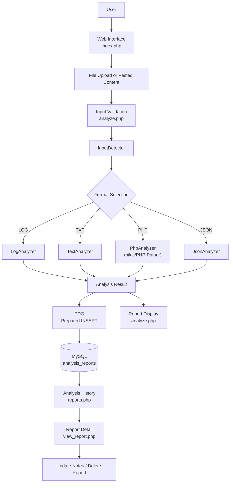

# Developer Automation Studio

A modular PHP web application that analyzes **LOG**, **TXT**, **PHP**, and **JSON** content, generates a structured report, and stores it in MySQL for later review.

Upload a file or paste content. The application validates the input, detects its format, routes it to a format-specific analyzer, saves the report, and displays the result.

---

## Table of Contents

1. [Project Overview](#1-project-overview)
2. [Problem Statement](#2-problem-statement)
3. [Project Objectives](#3-project-objectives)
4. [Key Features](#4-key-features)
5. [Supported File Formats and Capabilities](#5-supported-file-formats-and-capabilities)
6. [System Architecture](#6-system-architecture)
7. [Application Workflow](#7-application-workflow)
8. [Module Details](#8-module-details)
9. [Technical Implementation and Concepts](#9-technical-implementation-and-concepts)
10. [Database Architecture and Schema](#10-database-architecture-and-schema)
11. [CRUD Operations and Report Management](#11-crud-operations-and-report-management)
12. [Security Implementation](#12-security-implementation)
13. [Technology Stack](#13-technology-stack)
14. [Project Folder Structure](#14-project-folder-structure)
15. [Installation and Configuration](#15-installation-and-configuration)
16. [Running the Application Locally](#16-running-the-application-locally)
17. [Testing and Validation](#17-testing-and-validation)
18. [Sample Inputs and Analysis Outputs](#18-sample-inputs-and-analysis-outputs)
19. [Current Implementation Status](#19-current-implementation-status)
20. [Future Enhancements](#20-future-enhancements)
21. [Conclusion](#21-conclusion)

---

## 1. Project Overview

Developer Automation Studio is a PHP and MySQL application that brings several routine file-inspection tasks into one interface. A user supplies a file (or pastes text), and the application:

1. Validates the request and the content.
2. Detects whether the content is LOG, TXT, PHP, or JSON.
3. Runs the matching analyzer class.
4. Saves the structured result as a row in the `analysis_reports` table using PDO.
5. Shows the analysis, and keeps it available through an analysis history and a per-report detail page.

Saved reports can have developer notes added or edited, and can be deleted.

This is a learning and portfolio project that runs on a local Apache, PHP, and MySQL stack. It has no user accounts and has not been prepared or audited for production deployment.

## 2. Problem Statement

Developers regularly inspect different kinds of files: application logs, plain text, source code, and JSON data. Doing this by hand has recurring problems:

- Each format needs different analysis logic.
- Large files are slow to read manually, and repeated errors or structural details are easy to miss.
- Results are rarely recorded in a consistent form, so they cannot be easily revisited.

## 3. Project Objectives

- Provide one interface for analyzing four file formats.
- Select the analyzer from the content, not only from the file extension.
- Keep each format's logic in its own class so it can be maintained and tested separately.
- Store results in a consistent, queryable form in MySQL.
- Apply basic input validation and safe database and output handling.
- Demonstrate practical backend concepts: OOP, AST parsing, recursive JSON traversal, PDO, and CRUD.

## 4. Key Features

| Feature | Description |
|---|---|
| Upload or paste | Accepts either an uploaded file or pasted content (not both in one request) |
| Content detection | `InputDetector` returns a detected type, a confidence value, and a reason |
| Four analyzers | Dedicated analyzers for LOG, TXT, PHP, and JSON |
| Structured reports | Each report has a summary and detailed findings stored as JSON |
| Failure handling | Invalid PHP and invalid JSON are recorded with status `FAILED` and an error message |
| Analysis history | Saved reports are listed and can be opened individually |
| Developer notes | Notes can be added to or edited on a saved report |
| Report deletion | A saved report can be deleted |
| Security checks | Upload validation, prepared statements, output escaping, CSRF tokens on update and delete |

## 5. Supported File Formats and Capabilities

Uploaded files must have one of the extensions `.log`, `.txt`, `.php`, or `.json`.

| Format | Analyzer | What it reports |
|---|---|---|
| LOG | `LogAnalyzer` | Total lines, total errors, message count per log level, repeated error messages, extracted timestamps |
| TXT | `TextAnalyzer` | Total lines, words, characters, paragraphs, non-empty lines, empty lines |
| PHP | `PhpAnalyzer` | Total lines; classes, interfaces, traits, functions, methods, variables; include/require dependencies with line numbers; potentially risky function calls with line numbers; syntax error and line on failure |
| JSON | `JsonAnalyzer` | Total lines, objects, arrays, properties, strings, numbers, booleans, null values, total values; syntax error on invalid JSON |

## 6. System Architecture



**In simple terms:** the user gives the application some content. `analyze.php` acts as the controller: it checks that the request is safe and well-formed, asks `InputDetector` what the content is, and hands it to the matching analyzer. The analyzer returns a plain PHP array of results. The controller adds the detection details to that array, saves everything to MySQL through PDO, and renders the report. Saved reports are read back later by the history and detail pages, which also handle notes updates and deletion.

## 7. Application Workflow

1. **Open the interface.** The user opens `index.php` and chooses a file upload or pastes content.
2. **Submit.** The form is sent by POST to `analyze.php`. Any other HTTP method receives `405 Method Not Allowed`.
3. **Validate the request structure.** The controller checks that the upload array and pasted value have the expected types. Malformed requests receive `400`.
4. **Enforce one input source.** Supplying both a file and pasted content, or neither, is rejected.
5. **Validate an uploaded file.** The controller checks the upload error code, the 5 MB size limit, the extension allowlist (`log`, `txt`, `php`, `json`), and `is_uploaded_file()`, then reads the temporary file with `file_get_contents()`.
6. **Handle pasted content.** The file name is set to `Pasted Content` and the pasted string is used as the content.
7. **Reject empty content.**
8. **Detect the format.** `InputDetector::detect()` receives the content and, for uploads, the file name. The extension is a fallback; the content is examined first. If the type is `UNKNOWN`, processing stops with a message.
9. **Select and run the analyzer.** `LOG`, `TXT`, `PHP`, or `JSON` maps to its analyzer, and `analyze()` is called with the content.
10. **Build the report.** A summary and status are set. For PHP and JSON the analyzer supplies the status (`SUCCESS` or `FAILED`) and summary. The detection details are added to the findings.
11. **Save the report.** A prepared `INSERT` stores the file name, file type, status, analyzer, summary, and the findings, warnings, and errors as JSON.
12. **Display the result.** The analysis page shows file information, summary, detection details, and format-specific results.
13. **Review later.** `reports.php` lists saved reports, `view_report.php?id=N` shows one report, and notes can be updated or the report deleted.

## 8. Module Details

### 8.1 `analyze.php` (controller)

Coordinates validation, detection, analyzer selection, database storage, and the result page. It requires `config/database.php` and the five classes in `analyzers/`. The uploaded content is read as a string and passed to an analyzer. It is never included, evaluated, or executed.

### 8.2 InputDetector

| Item | Detail |
|---|---|
| File | `analyzers/InputDetector.php` |
| Called as | `detect($content, $fileName)`; `$fileName` is `null` for pasted content |
| Returns | An array containing `type`, `confidence`, and `reason` |
| Possible types | `LOG`, `TXT`, `PHP`, `JSON`, or `UNKNOWN` |
| Purpose | Chooses the analyzer from the content itself, so a mislabeled file name does not decide the analysis. For uploads, the extension is used only when the content is not recognizable. |

The detection result is stored with the findings and shown on the report page.

### 8.3 LogAnalyzer

| Item | Detail |
|---|---|
| File | `analyzers/LogAnalyzer.php` |
| Output keys | `total_lines`, `total_errors`, `log_levels`, `repeated_errors`, `timestamps` |
| Behavior | Counts messages per log level (for example INFO, WARNING, ERROR, DEBUG), totals the errors, lists error messages that occur more than once with their counts, and extracts timestamps from supported entries |
| Summary | `Log file contains N lines and M errors.` |

### 8.4 TextAnalyzer

| Item | Detail |
|---|---|
| File | `analyzers/TextAnalyzer.php` |
| Output keys | `summary`, `total_lines`, `total_words`, `total_characters`, `total_paragraphs`, `non_empty_lines`, `empty_lines` |
| Behavior | Produces size and structure statistics for plain text |

### 8.5 PhpAnalyzer

| Item | Detail |
|---|---|
| File | `analyzers/PhpAnalyzer.php` |
| Dependency | `nikic/php-parser`, installed through Composer |
| Output keys | `status`, `summary`, `total_lines`, `total_classes`, `total_interfaces`, `total_traits`, `total_functions`, `total_methods`, `total_variables`, `classes`, `interfaces`, `traits`, `functions`, `methods`, `dependencies`, `risky_functions`, and on failure `error` and `error_line` |
| Behavior | Parses the source into an Abstract Syntax Tree and inspects it. Dependencies (include/require) and a defined set of potentially risky function calls (such as `eval`, `exec`, `shell_exec`, `system`, `passthru`) are reported with line numbers. |
| Failure | Code with a syntax error produces status `FAILED` with the parser's error message and line |

**The uploaded PHP is parsed, not executed.** PHP-Parser reads the code as text and builds a tree. Nothing in the submitted code runs. The "risky functions" list is an informational flag for review, not a security scan.

### 8.6 JsonAnalyzer

| Item | Detail |
|---|---|
| File | `analyzers/JsonAnalyzer.php` |
| Output keys | `status`, `summary`, `total_lines`, `total_objects`, `total_arrays`, `total_properties`, `total_strings`, `total_numbers`, `total_booleans`, `total_nulls`, `total_values`, and on failure `error` |
| Behavior | Validates the JSON, then walks the decoded structure recursively, counting each kind of value |
| Failure | Invalid JSON produces status `FAILED` and a syntax error message instead of counts |

### 8.7 Report pages

| File | Responsibility |
|---|---|
| `index.php` | Input form (upload or paste) |
| `reports.php` | Analysis history |
| `view_report.php` | Single report view, notes display and edit form |
| `update_report.php` | Saves edited notes |
| `delete_report.php` | Deletes a report |
| `assets/` | Stylesheet used by the pages |
| `config/` | Database connection configuration |

## 9. Technical Implementation and Important Concepts

| Concept | What it means | Why it is used here | Where it is implemented | Contribution |
|---|---|---|---|---|
| **Object-Oriented Programming** | Organizing code into classes that bundle data and behavior | Each analysis responsibility is a separate class with its own `analyze()` logic | `analyzers/` (five classes), instantiated in `analyze.php` | Keeps format logic isolated and replaceable |
| **Modular architecture** | Splitting an application into parts with single responsibilities | Validation, detection, analysis, storage, and presentation change for different reasons | Controller (`analyze.php`), detector, analyzers, `config/`, report pages | A new format means a new analyzer plus one routing branch |
| **File handling** | Receiving, checking, and reading uploaded files safely | Users upload arbitrary files | `analyze.php`: `$_FILES` checks, size limit, extension allowlist, `is_uploaded_file()`, `file_get_contents()` | Only expected files are read, and read from PHP's temporary location |
| **Content detection** | Deciding what a piece of content is by examining it | Pasted content has no file name, and file names can be wrong | `InputDetector`, called from `analyze.php` | Selects the correct analyzer and records confidence and reason |
| **Abstract Syntax Tree (AST) parsing** | Converting source code into a tree of nodes (classes, methods, calls) without running it | Reliable code inspection needs structure, not text search | `PhpAnalyzer` using `nikic/php-parser` | Accurate counts of classes, methods, and calls, with line numbers, and no code execution |
| **JSON parsing and recursive traversal** | Decoding JSON into nested arrays and visiting every nested value | JSON can nest to any depth, so counting needs a function that calls itself on children | `JsonAnalyzer`; `json_decode()` is also used to read stored findings in `view_report.php` | Counts objects, arrays, and value types at every level |
| **PDO and prepared statements** | A database access layer where the SQL is sent separately from the values | Values from users and analyzers must never be concatenated into SQL | `getDatabaseConnection()` in `config/`; all queries in `analyze.php`, `view_report.php`, `update_report.php`, `delete_report.php` | Safe parameter binding for every query |
| **MySQL CRUD** | Create, Read, Update, Delete operations on stored data | Reports must be saved, listed, annotated, and removed | See [Section 11](#11-crud-operations-and-report-management) | Persistent report management |
| **Input validation** | Checking data is of the expected form before using it | Requests can be malformed or malicious | Type checks, size and extension checks, `ctype_digit()` on IDs, notes length limit | Invalid input is rejected early with an appropriate status |
| **HTML output escaping** | Converting special characters so data displays as text, not markup | Reports display file names and file content fragments | `escapeHTML()` wrapping `htmlspecialchars(..., ENT_QUOTES, 'UTF-8')` in `analyze.php` and `view_report.php` | Prevents stored or submitted content from running as HTML or script |
| **Error handling** | Anticipating failures and responding in a controlled way | Uploads fail, SQL can fail, input can be invalid | HTTP status codes (400, 403, 404, 405, 500); `try/catch (PDOException)` with `error_log()` in the report pages | Users get a short message; technical detail goes to the server log |
| **Sessions and CSRF tokens** | A per-session random token that must accompany state-changing requests | Update and delete change stored data | Token created with `random_bytes(32)` in `view_report.php`; verified with `hash_equals()` in `update_report.php` and `delete_report.php` | Blocks forged update and delete requests from other sites |
| **Composer dependency management** | A tool that downloads and locks PHP library versions | The PHP analyzer relies on a third-party parser | `composer.json`, `composer.lock`; generated `vendor/` is excluded from Git | Reproducible installation with `composer install` |

## 10. Database Architecture and Schema

The application uses one table, `analysis_reports`, in a MySQL database named `developer_automation_db`.

```sql
CREATE DATABASE developer_automation_db;
USE developer_automation_db;

CREATE TABLE analysis_reports (
    id BIGINT UNSIGNED AUTO_INCREMENT PRIMARY KEY,
    file_name VARCHAR(255) NOT NULL,
    file_type VARCHAR(20) NOT NULL,
    status ENUM('SUCCESS', 'PARTIAL', 'FAILED') NOT NULL,
    analyzer VARCHAR(100) NOT NULL,
    summary TEXT,
    findings JSON,
    warnings JSON,
    errors JSON,
    notes TEXT,
    analyzed_at TIMESTAMP DEFAULT CURRENT_TIMESTAMP
);
```

| Column | Purpose |
|---|---|
| `id` | Unique report identifier |
| `file_name` | Uploaded file name, or `Pasted Content` |
| `file_type` | Detected format: LOG, TXT, PHP, or JSON |
| `status` | `SUCCESS`, `PARTIAL`, or `FAILED` |
| `analyzer` | Analyzer class used |
| `summary` | Short text summary |
| `findings` | Full analyzer result, plus the `input_detection` block, as JSON |
| `warnings` | Warnings as JSON |
| `errors` | Errors as JSON; on a failed analysis it holds the error message and line |
| `notes` | Developer notes added after analysis |
| `analyzed_at` | Creation timestamp |

Design notes:

- Each format produces different fields, so the full result is stored as one JSON document in `findings` instead of separate columns per format.
- The `status` column permits `PARTIAL`, but the current controller assigns `SUCCESS` or `FAILED`.
- The `warnings` column is written as an empty list by the current controller.

## 11. CRUD Operations and Report Management

| Operation | File | SQL | Behavior |
|---|---|---|---|
| **Create** | `analyze.php` | `INSERT INTO analysis_reports (...) VALUES (:file_name, ...)` | Stores a new report after analysis |
| **Read (list)** | `reports.php` | `SELECT` on `analysis_reports` | Shows analysis history |
| **Read (one)** | `view_report.php` | `SELECT * FROM analysis_reports WHERE id = :id` | Validates the ID, returns 404 if not found, decodes the JSON columns |
| **Update** | `update_report.php` | `UPDATE analysis_reports SET notes = :notes WHERE id = :id` | POST only; requires a valid CSRF token; confirms the report exists; limits notes to 10,000 bytes; redirects to the report with `updated=1` |
| **Delete** | `delete_report.php` | `DELETE FROM analysis_reports WHERE id = :id` | POST only; requires a valid CSRF token; reports "not found or already deleted" when no row is affected; redirects to history with `deleted=1` |

On the report page, notes are shown in a saved-notes panel. An edit button reveals a form (a small amount of JavaScript toggles the panel), and the form posts to `update_report.php`.

## 12. Security Implementation

| Safeguard | Implementation |
|---|---|
| Request method restriction | `analyze.php`, `update_report.php`, and `delete_report.php` accept POST only (405 otherwise) |
| Input structure checks | Upload array and pasted value are type-checked before use |
| Single input source | A request with both a file and pasted content, or neither, is rejected |
| Upload error check | `UPLOAD_ERR_OK` required |
| Upload size limit | 5 MB, applied to uploaded files |
| Extension allowlist | `log`, `txt`, `php`, `json` only |
| Upload origin check | `is_uploaded_file()` on the temporary file |
| File name handling | `basename()` applied to the supplied name |
| Prepared statements | All database queries use PDO prepared statements with bound parameters |
| ID validation | Report IDs must pass `ctype_digit()` and are cast to integers |
| Output escaping | `htmlspecialchars()` with `ENT_QUOTES` and UTF-8 for displayed values |
| CSRF protection | Session token (`random_bytes(32)`), compared with `hash_equals()`, on notes update and report delete |
| Notes length limit | Notes limited to 10,000 bytes on the server and `maxlength` on the form |
| Controlled error output | Database exceptions are written to `error_log()`; users see a generic message |
| No code execution | Uploaded PHP is parsed into an AST and never executed |
| Credentials kept private | `config/database.php` is excluded from Git; only `database.example.php` is committed |

**Limitations of the current design (stated explicitly):**

- There is no authentication or user accounts; anyone who can reach the application can view and manage all reports.
- The 5 MB limit applies to uploads. Pasted content is bounded only by the PHP server configuration.
- The analysis endpoint does not use a CSRF token.
- These are application-level safeguards. The project has not been security-audited and is not presented as production-ready.

## 13. Technology Stack

| Layer | Technology |
|---|---|
| Backend language | PHP (developed against PHP 8.4) |
| Database | MySQL / MariaDB |
| Database access | PDO |
| PHP parsing | `nikic/php-parser` |
| Dependency management | Composer |
| Frontend | HTML, CSS, and a small amount of JavaScript for the notes editor |
| Local server | Apache (XAMPP) |
| Version control | Git and GitHub |

## 14. Project Folder Structure

```text
Developer-Automation-Studio/
├── analyzers/
│   ├── InputDetector.php
│   ├── LogAnalyzer.php
│   ├── TextAnalyzer.php
│   ├── PhpAnalyzer.php
│   └── JsonAnalyzer.php
├── assets/
│   └── style.css
├── config/
│   └── database.example.php
├── analyze.php
├── check_css.php
├── delete_report.php
├── index.php
├── reports.php
├── update_report.php
├── view_report.php
├── test_input_detector.php
├── test_insert.php
├── test_invalid_json.php
├── test_json_analyzer.php
├── test_log_analyzer.php
├── test_php_analyzer.php
├── composer.json
├── composer.lock
└── .gitignore
```

Not committed: the local `config/database.php` (credentials) and the Composer-generated `vendor/` directory.

## 15. Installation and Configuration

**Prerequisites:** PHP 8.4 or a compatible version, Composer, MySQL or MariaDB, and Apache (XAMPP works for local development).

1. **Clone the repository**

   ```bash
   git clone https://github.com/naveen-nhce26/Developer-Automation-Studio.git
   cd Developer-Automation-Studio
   ```

2. **Install dependencies**

   ```bash
   composer install
   ```

3. **Create the database and table** by running the SQL in [Section 10](#10-database-architecture-and-schema).

4. **Configure the connection**

   ```bash
   cp config/database.example.php config/database.php
   ```

   Edit `config/database.php` with your local host, port, database name (`developer_automation_db`), username, and password. Keep this file private and do not commit it.

## 16. Running the Application Locally

1. Place the project folder in XAMPP's `htdocs` directory.
2. Start Apache and MySQL from the XAMPP Control Panel.
3. Open the application:

   ```text
   http://localhost/Developer-Automation-Studio/
   ```

4. Upload a `.log`, `.txt`, `.php`, or `.json` file, or paste content, then submit.
5. Open the analysis history to view, annotate, or delete saved reports.

Adjust the URL if your folder name or Apache port is different.

## 17. Testing and Validation

Testing is done with standalone PHP scripts in the repository root and with manual runs through the web interface. There is no automated test framework.

| Script | Purpose |
|---|---|
| `test_input_detector.php` | Exercises content detection |
| `test_log_analyzer.php` | Runs `LogAnalyzer` |
| `test_php_analyzer.php` | Runs `PhpAnalyzer` |
| `test_json_analyzer.php` | Runs `JsonAnalyzer` with valid JSON |
| `test_invalid_json.php` | Checks handling of invalid JSON |
| `test_insert.php` | Checks saving a report to MySQL |

Manual validation covered uploading and pasting each format, analysis of inputs of roughly 1,000 lines, and the report workflow (save, view history, open a report, update notes, delete).

## 18. Sample Inputs and Analysis Outputs

The figures below are **recorded results from test runs** on generated sample files of roughly 1,000 lines. They illustrate the kind of output each analyzer produces; they are not performance benchmarks, and other inputs produce other values.

### 18.1 LOG (test input: `large_test.log`)

```text
Detected type : LOG
Analyzer      : LogAnalyzer
Status        : SUCCESS
Summary       : Log file contains 1000 lines and 250 errors.

Total Lines       : 1000
Total Errors      : 250
INFO Messages     : 250
WARNING Messages  : 250
ERROR Messages    : 250
DEBUG Messages    : 250
```

The full report also lists repeated error messages with their counts, and the extracted timestamps.

### 18.2 TXT (test input: `large_test.txt`)

```text
Detected type : TXT
Analyzer      : TextAnalyzer
Status        : SUCCESS

Total Words       : 24000
Total Characters  : 167000
Total Paragraphs  : 1
Non-empty Lines   : 1000
Empty Lines       : 1
```

### 18.3 PHP (test input: `large_test.php`)

```text
Detected type : PHP
Analyzer      : PhpAnalyzer
Status        : SUCCESS

Classes    : 1
Methods    : 2
Variables  : 2
```

When present in the source, the report also lists interfaces, traits, functions, include/require dependencies, and potentially risky function calls with line numbers.

### 18.4 JSON (test input: `large_test.json`)

```text
Detected type : JSON
Analyzer      : JsonAnalyzer
Status        : SUCCESS

Objects      : 997
Arrays       : 1
Properties   : 5977
Strings      : 2889
Numbers      : 1992
Booleans     : 996
Null Values  : 99
```

### 18.5 General behavior (not test results)

- Invalid JSON, or PHP with a syntax error, is saved with status `FAILED` and an error message (and, for PHP, an error line) instead of counts.
- Content that cannot be classified is rejected before analysis and is not saved.

## 19. Current Implementation Status

| Area | Status |
|---|---|
| Upload and paste input with validation | Implemented |
| Content detection (LOG, TXT, PHP, JSON) | Implemented |
| LogAnalyzer, TextAnalyzer, PhpAnalyzer, JsonAnalyzer | Implemented |
| PDO storage of reports in MySQL | Implemented |
| Analysis history and report detail pages | Implemented |
| Report notes (add and update) with CSRF protection | Implemented |
| Report deletion with CSRF protection | Implemented |
| Standalone test scripts | Implemented |
| Saved-report detail view | The stored findings are rendered in detail for LOG and TXT reports; PHP and JSON detailed results are shown on the immediate analysis page, and their full findings are stored in the `findings` column |
| Authentication, API, automated test suite, deployment | Not implemented |

## 20. Future Enhancements

These are planned improvements and are **not** part of the current application:

- Render full PHP and JSON findings on the saved-report detail page.
- REST API endpoints for report operations.
- Dashboard and visualization improvements for report history.
- An automated test suite (for example PHPUnit) with broader coverage.
- Support for additional file formats.
- Authentication, an application-level limit on pasted content, a CSRF token on the analysis form, and further hardening before any production use.

## 21. Conclusion

Developer Automation Studio is a working, modular PHP application that detects LOG, TXT, PHP, and JSON content, analyzes it with format-specific classes, and stores structured reports in MySQL. It combines object-oriented design, AST parsing with PHP-Parser, recursive JSON analysis, PDO prepared statements, full CRUD report management, and layered input validation. It is a local-development project with clearly stated limitations, and the planned improvements above are the next steps toward a more complete tool.
